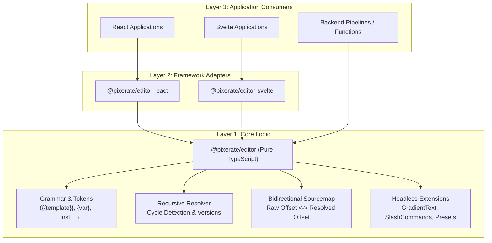

# @pixerate/editor

<p align="center">
  <strong>A high-performance, UI-agnostic media and rich-text editing engine with first-class JavaScript, React, and Svelte packages.</strong>
</p>

<p align="center">
  <a href="https://www.npmjs.com/package/@pixerate/editor"></a>
  <a href="https://www.npmjs.com/package/@pixerate/editor-react"></a>
  <a href="https://www.npmjs.com/package/@pixerate/editor-svelte"></a>
  <a href="https://github.com/Pixerate/editor/actions/workflows/ci.yml"></a>
  <a href="https://github.com/Pixerate/editor/blob/main/LICENSE"></a>
</p>

---

## 🌟 Overview

`@pixerate/editor` is designed from the ground up for modern creative workflows—powering both **prompt-engineering studios** and **document-level rich-text editors**.

### Core Capabilities
- 🚀 **UI-Agnostic Core (`@pixerate/editor`)**: Pure TypeScript token parser, AST tokenizer, recursive template resolution with cycle detection, bidirectional character sourcemapping, and headless TipTap/ProseMirror extensions. Usable in Node.js, Web Workers, Firebase Functions, or custom vanilla DOM frontends.
- ⚛️ **React Bindings (`@pixerate/editor-react`)**: Drop-in `usePromptEditor` hook, `<EditorContent />`, contextual `<BubbleMenu />`, and lightweight read-only `<TemplateRenderer />`.
- 🧡 **Svelte 5 Bindings (`@pixerate/editor-svelte`)**: Native runes-based state management, drop-in `<EditableTextNodeEditor />`, `<BubbleMenu />`, `<TemplateRenderer />`, and `<SpreadsheetEditor />`.
- 🕸️ **Headless Canvas Runes (`@pixerate/editor-svelte/canvas`)**: Svelte 5 runes toolkit for high-performance node graph manipulation, Dagre auto-layout, serialized JSON clipboard, drag-to-dock intersection tracking, and hotkeys on top of `@xyflow/svelte`.
- 🎨 **Dynamic Syntax Styling**: Inline gradient animations for `{{template}}` tags, badges for `{variable}` fields, and italic styling for `__instructions__`.
- ⚡ **Plain Text Invariant**: Guarantees raw string multiline format without leaking HTML artifacts, preserving newline paragraph breaks across clipboard paste and export.
- 🗺️ **Bidirectional Sourcemaps**: Trace character offsets from rendered output directly back to source templates for error reporting and precision highlighting.

---

## 📦 Packages

| Package | Description | Target Consumers |
| :--- | :--- | :--- |
| [`@pixerate/editor`](./packages/core#readme) | Pure TS core, grammar parser, resolvers, serializers, headless extensions and controllers | Node.js, Workers, Vanilla JS |
| [`@pixerate/editor-react`](./packages/react#readme) | React hooks, TipTap wrappers, AST renderer, spreadsheet / image / canvas components | React apps, Next.js, Vite React |
| [`@pixerate/editor-svelte`](./packages/svelte#readme) | Svelte 5 runes bindings & components (shipped as sources, SSR-compatible) | Svelte apps, SvelteKit apps |
| [`@pixerate/editor-svelte/canvas`](./packages/svelte/src/canvas) | Headless Svelte 5 graph/flow canvas runes & math | SvelteFlow canvas & diagram apps |

See the npm badges above for current versions. Each package README covers installation, API and styling.

> **Styling:** the React and Svelte components are styled with Tailwind CSS utility classes and shadcn-style theme tokens. Your Tailwind setup must scan the package and define those tokens. See the *Styling* section of the [React](./packages/react#styling-tailwind-css-required) or [Svelte](./packages/svelte#styling-tailwind-css-required) README.

---

## 🏗️ Architecture



---

## 🚀 Quickstart

### 1. React (Prompt Studio)

```tsx
import React, { useState } from "react";
import { usePromptEditor, EditorContent, TemplateRenderer } from "@pixerate/editor-react";

export function PromptStudio() {
  const [prompt, setPrompt] = useState("A photo of {subject} in {{golden_hour}}");

  const templates = [
    { name: "golden_hour", body: "warm 35mm volumetric lighting" }
  ];

  const editor = usePromptEditor({
    content: prompt,
    onContentChange: setPrompt,
    templates,
    placeholder: "Write your prompt here...",
  });

  return (
    <div>
      <EditorContent editor={editor} className="editor-box" />

      {/* Lightweight read-only AST preview (zero TipTap overhead) */}
      <TemplateRenderer content={prompt} templates={templates} />
    </div>
  );
}
```

### 2. Svelte (Rich Document)

```svelte
<script lang="ts">
  import type { Editor } from "@tiptap/core";
  import { EditableTextNodeEditor } from "@pixerate/editor-svelte";

  let editor = $state<Editor>();
  let html = $state("<p>Start editing your rich document...</p>");
  let editable = $state(true);
</script>

<EditableTextNodeEditor
  bind:editor
  content={html}
  {editable}
  placeholder="Type anything..."
  class="prose max-w-none"
  onUpdate={() => (html = editor?.getHTML() ?? html)}
/>
```

### 3. Core (Node.js / Headless Functions)

```typescript
import {
  tokenizePrompt,
  resolveTemplates,
  resolveTemplatesWithMapping,
} from "@pixerate/editor";

const templates = [
  { name: "mood", body: "cinematic cyber-noir" },
  { name: "scene", body: "rainy street with {{mood}}" }
];

// 1. AST Tokenization
const tokens = tokenizePrompt("Shot of {{scene}}");

// 2. Recursive Template Resolution with Cycle Detection
const resolved = resolveTemplates("Shot of {{scene}}", templates);
// -> "Shot of rainy street with cinematic cyber-noir"

// 3. Offset Mapping
const { text, map } = resolveTemplatesWithMapping("Shot of {{scene}}", templates);

// 4. Variable defaults, descriptions and conditional sections
resolveTemplates("A {subject|red fox|Describe it}{?style} by {style}{/style}", [], {
  values: { style: "Monet" },
});
// -> "A red fox by Monet"
```

See [docs/prompt-engine.md](./docs/prompt-engine.md) for the full grammar, fill-in form helpers and source map details.

---

## ⚖️ Feature Parity Guarantee

We maintain **strict 1:1 parity** across JavaScript, React, and Svelte:

| Feature | Vanilla Core | React | Svelte |
| :--- | :---: | :---: | :---: |
| AST Tokenizer (`tokenizePrompt`) | ✅ | ✅ | ✅ |
| Recursive Template Resolution | ✅ | ✅ | ✅ |
| Cycle Detection (`[Template loop detected]`) | ✅ | ✅ | ✅ |
| Bidirectional Sourcemapping | ✅ | ✅ | ✅ |
| Variable Defaults & Descriptions (`{name\|default\|description}`) | ✅ | ✅ | ✅ |
| Conditional Sections (`{?name}…{/name}`, `{!name}…{/name}`) with Diagnostics | ✅ | ✅ | ✅ |
| Resolution with Values (`values` option, `resolvePrompt`) | ✅ | ✅ | ✅ |
| Variable Fill-In Form (`getVariableFormFields` / `<VariableForm />`) | Headless | Component | Component |
| Value Preview in `<TemplateRenderer values />` | `evaluatePromptTokens` | ✅ | ✅ |
| Comparison Conditions (`{?amount>100}…{/amount}`, `= <> < > <= >=`) | ✅ | ✅ | ✅ |
| Mail-Merge Data Sources (`parseDataSource`, `matchFields`: CSV/TSV/JSON, fuzzy field matching) | ✅ | Via core | Via core |
| Multi-Record Merge & Preview (`mergeRecords` / `<MergePreview />`) | Headless | `<MergePreview />` & `useMergePreview` | `<MergePreview />` & `createMergePreview` |
| Plain Text Clipboard & Linebreak Parser | ✅ | ✅ | Via core¹ |
| Live Animated Gradient Text | ✅ | ✅ | Via core¹ |
| Slash Command Trigger (`/command`) | ✅ | ✅ | Via core¹ |
| Template Autocomplete (`{{`) | ✅ | ✅ | Via core¹ |
| Read-Only Token Renderer (`<TemplateRenderer />`) | AST Only | Component | Component |
| Floating Bubble Formatting Menu | Headless | Component | Component |
| Rich Text Preset (Headings, Lists, Task Lists, Links) | ✅ | ✅ | ✅ |
| Smilies (`:)` -> `🙂`) & Hex Highlighter | ✅ | ✅ | ✅ |
| Heading Outline & Navigation Panel (`outline`) | Headless (`createOutlineStore`) | `<OutlinePanel />` & `useOutline` | `<OutlinePanel />` & `createOutline` |
| Table of Contents Block (`tableOfContents`, `[[toc]]`) | ✅ | ✅ | ✅ |
| Footnotes (`footnotes`, markdown `[^n]`) | ✅ | ✅ | ✅ |
| Bookmarks & Cross-References (`bookmarks`, `crossReferences`) | ✅ | ✅ | ✅ |
| Autocorrect Rules & Exceptions (`autocorrect`) | ✅ | ✅ | ✅ |
| Document-Structure Slash/Toolbar Items (`getDocumentStructureCommandItems`) | ✅ | Via core | Via core |
| Image Editor Canvas 2D Engine & Transformations | ✅ | Component & Hook | Component & Rune |
| Image Filters & Adjustments | ✅ | ✅ | ✅ |
| Image White Balance (Temperature / Tint, eyedropper) & Process Versions | ✅ | ✅ | ✅ |
| Image Adjustment Layers (Curves, Levels, Hue/Saturation, Vibrance, Color Balance, B&W, Photo Filter, …) | ✅ | `<AdjustmentLayersPanel>` & `<CurvesEditor>` | `<AdjustmentLayersPanel>` & `<CurvesEditor>` |
| Photoshop Blend Modes (layers & annotations) | `blendPixel` & `BLEND_MODES` | ✅ | ✅ |
| Image Histogram | `computeHistogram` | `<Histogram>` & `useImageHistogram` | `<Histogram>` & `createImageHistogram` |
| Image Adjustment Control Table & Agent Tools | `IMAGE_ADJUSTMENT_CONTROLS` & `createImageEditorToolProvider` | `<ControlSlider>` | `<ControlSlider>` |
| Vector Annotations (Pen, Rect, Circle, Arrow, Line, Text) | ✅ | ✅ | ✅ |
| Gleamforge Depth & Alpha Masking | ✅ | ✅ | ✅ |
| Canvas Align / Distribute / Make Same Size | ✅ | `useCanvasArrange` | `createCanvasArrange` |
| Canvas Lock / Unlock & Layer Order (Front / Back) | ✅ | `useCanvasArrange` | `createCanvasArrange` |
| Canvas Smart Guides & Snap-to-Shape (edges, centres, spacing) | ✅ | Hook & `<CanvasGuidesLayer>` | Rune & `<CanvasGuidesLayer>` |
| Canvas Resize & Grid Snapping | `snapResize` & `snapToGrid` | `useCanvasArrange` (`snapResizeChanges`) | `createCanvasArrange` (`resizerHandlers`) |
| Canvas Distance Measuring (Alt-hover) | `measureBetween` & `measureSelection` | `useCanvasMeasure` & `<CanvasGuidesLayer>` | `createCanvasMeasure` & `<CanvasGuidesLayer>` |
| Canvas Auto Layout & Constraints (stack, wrap, grid, hug / fill) | `layoutFrame`, `layoutAll`, `layoutUp` & `createCanvasAutoLayoutController` | `useCanvasAutoLayout` | `createCanvasAutoLayout` |
| Canvas Auto Layout Drag Reorder | `getAutoLayoutInsertTarget` & `moveLayoutChild` | `useCanvasAutoLayout` (`noteChanges`) | `createCanvasAutoLayout` (`dragReorder`) |
| Canvas Bézier Curve Fitting (boolean results, freehand) | `fitCubics` & `fitPathData` | Via core | Via core |
| Canvas Scenes (saved viewports, next / previous) | `CanvasScenesStore` | `useCanvasScenes` | `createCanvasScenes` |
| Canvas Connector Snapping to Shape Sides | ✅ | Via core | Via core |
| Canvas Arrange Keyboard Shortcuts | `matchArrangeShortcut` | `useCanvasArrangeShortcuts` | `createCanvasArrangeShortcuts` |
| Canvas Shape Boolean Ops (Unite / Intersect / Subtract / Exclude / Divide) | `combineShapeNodes` & `polygonBoolean` | `useCanvasArrange` | `createCanvasArrange` |
| Canvas Shape Nodes (rect, ellipse, polygon, star, SVG path) | `getShapeRenderData` | `<ShapeNode>` | `<ShapeNode>` |
| Comments (threads, replies, resolve, orphan detection, JSON) | Extension & `CommentStore` | `CommentsPanel`, `CommentButton`, `useComments` | `CommentsPanel`, `CommentButton`, `createComments` |
| Track Changes (insert/delete marks, accept/reject, navigation) | Extension & `getTrackedChanges` | `ReviewToolbar`, `useTrackChanges` | `ReviewToolbar`, `createTrackChanges` |
| Tracked-content export (`trackedChanges: "accepted"` default) | ✅ | Via core | Via core |
| Tracked formatting changes (`formatChange` mark, accept/reject, descriptions) | ✅ | `ReviewToolbar` description | `ReviewToolbar` description |
| Tracked block changes (heading/list/quote/alignment, `blockChange` attribute) | ✅ | `ReviewToolbar` description | `ReviewToolbar` description |
| Tracked edits inside code blocks | ✅ | Via core | Via core |
| Compare Documents into tracked changes (word/char, ignore case/white space, formatting, whole-block insert/delete) | `compareDocuments`, `compareHtml`, `diffSequences` (`@pixerate/editor/compare`) & `setContentFromComparison` | `useDocumentCompare` | `createDocumentCompare` |
| Find & Replace (Word `^` codes, wildcards with `\1` groups, regex, match options; skips tracked deletions, tracked replacements) | `FindReplace` (`findReplace` preset option) | `FindReplaceBar`, `useFindReplace` | `FindReplaceBar`, `createFindReplace` |
| File Import Registry (`.md`, `.html`, `.txt`, `.rtf`, `.docx`; pluggable adapters) | ✅ | `useFileImport` + `fileImport` | `createFileImport` + `fileImport` prop |
| Drag-and-Drop File Import at Drop Position | `FileImport` | ✅ | ✅ |
| DOCX Import (headings, lists, tables, links, images, footnotes; dependency-free) | `docxImportAdapter` | Via core | Via core |
| PDF Text Import (injected pdf.js, opt-in) | `createPdfImportAdapter` | Via core | Via core |
| Zipped Export Import (Notion / Confluence `.zip`, opt-in) | `zipImportAdapter` | Via core | Via core |
| Safe ZIP Reader (deflate via `DecompressionStream`, ZIP64, bomb / traversal guards) | `readZip` | Via core | Via core |
| Rich Clipboard MIME (`application/x.pixerate.document+json`) | `RichClipboard` | `richClipboard` | `richClipboard` prop |
| Dynamic Agent Tool Registry (MCP `tools/list` / `tools/call`, `listChanged`) | `ToolRegistry` | `useAgentToolProvider` | `useAgentToolProvider` |
| Command Registry (enablement with reasons, strict params, structured results) | `CommandRegistry` (`/commands`) | `useRegisterCommands` | `useRegisterCommands` |
| Shortcuts as Data (`Mod`, scopes, user overrides, per-platform conflict audit) | `ShortcutMap` & `formatShortcut` | `useCommandShortcuts` | `createCommandShortcuts` |
| Command Palette (fuzzy ranking, recents, shortcuts, disabled reasons) | `rankCommands` & `createCommandPaletteController` | `<CommandPalette>` & `useCommandPalette` | `<CommandPalette>` & `createCommandPalette` |
| Commands as Agent Tools (`list_commands`, `run_command`, `run_commands`) | `createCommandToolProvider` | Via core | Via core |
| Built-in Commands (history undo/redo, canvas arrange, spreadsheet table) | `createHistoryCommands`, `createArrangeCommands`, `createSpreadsheetCommands` | Via core | Via core |
| Spreadsheet Sort (multi-column, range) & Transpose | ✅ | ✅ | ✅ |
| Spreadsheet Filters (per-column rules, toggle) | ✅ | ✅ | ✅ |
| Spreadsheet Freeze Panes, Header & Footer Rows | ✅ | ✅ | ✅ |
| Spreadsheet Hide/Unhide Rows & Columns | ✅ | ✅ | ✅ |
| Spreadsheet Merged Cells | ✅ | ✅ | ✅ |
| Spreadsheet Autofill (fill handle, series, formula shifting) | ✅ | ✅ | ✅ |
| Spreadsheet Categories (grouped rows, summaries, collapse) | ✅ | ✅ | ✅ |
| Spreadsheet CSV Import/Export (RFC 4180) | ✅ | ✅ | ✅ |
| Spreadsheet CSV / TSV File Import Adapters (import registry) | `importFileIntoSpreadsheet` | Via core | Via core |
| Spreadsheet Clipboard (TSV + HTML + lossless JSON) | ✅ | ✅ | ✅ |
| Spreadsheet Table Context Menu | Headless | Component | Component |
| Spreadsheet Formula Function Registry (86 functions, `registerFormulaFunction`) | ✅ | Via core | Via core |
| Spreadsheet Typed Input (numbers, currency, %, dates, times) & Excel Comparisons | `parseCellInput` / `formatCellDisplay` | Formatted cell display | Formatted cell display |
| Excel Number Formats (sections, `[Red]`, `[>=100]`, fractions, `E+`, `[h]:mm`, `TEXT()`, built-ins 0–49) | `NumberFormat` / `formatCellForDisplay` | Coloured, right-aligned numbers | Coloured, right-aligned numbers |
| Spreadsheet Cell & Column Number Formats (undoable, "Format cells" presets + custom code) | `setCellNumberFormat` / `setColumnNumberFormat` | Context menu | Context menu |
| Formula Error Diagnostics (`CellData.errorMessage`, error cell tooltips) | ✅ | ✅ | ✅ |
| Formula Autocomplete & Argument Hints (`<FormulaHints />`) | Headless (`getFormulaHints`) | Component | Component |
| Spreadsheet Dynamic Arrays (spilling, `#SPILL!`, `A1#` spill references) | `getSpillAt` / `getSpills` | Spill border + greyed formula bar | Spill border + greyed formula bar |
| Array Functions (FILTER, SORT, SORTBY, UNIQUE, SEQUENCE, TRANSPOSE, RANDARRAY, LET) & array arithmetic | ✅ | Via core | Via core |
| Formula Date Arithmetic (`date ± days`, `date - date`, chronological date comparisons) | ✅ | Via core | Via core |
| History Gesture Merge Keys & Held Gestures (`executeMerged(cmd, { key })`, `beginGesture` / `endGesture`) | `HistoryManager` | `useHistory` | `createHistory` |
| History Undo Marks / Escape-Cancel (`mark`, `revertTo`) | `HistoryManager` | `useHistory` | `createHistory` |
| History Panel & Memory Budget (`getEntries`, `goTo`, `maxBytes` / `sizeOf`) | `HistoryManager` | `useHistory().entries` | `createHistory().entries` |
| Dirty-vs-Saved Tracking (undo-to-saved is clean, `normalize`, `suppress`) | `DirtyTracker` & `bindDirtyToHistory` | `useHistoryDirty` | `createHistoryDirty` |
| Autosave & Crash Recovery (hydration gate, backoff retry, flush on page hide, own-snapshot-only clean) | `createAutosaveController` & `createRecoveryPolicy` (`/persistence`) | `useAutosave` & `<RecoveryPrompt>` | `createAutosave` & `<RecoveryPrompt>` |
| Storage Adapters (memory, localStorage, IndexedDB, OPFS with atomic writes) | `create*Storage` / `create*Adapter` | Via core | Via core |
| Document Migration & Load Reports (step-wise `migrateDocument`, per-section fallback, read-only newer versions) | `migrateDocument`, `loadSections`, `loadImageEditorDocument` | Via core | Via core |
| Generation Model Capabilities & Request Planning (snap / clamp / truncate, strategies) | `planGenerationRequest` (`/generation`) | `useGenerationPlan` | `createGenerationPlan` |
| Generation Settings Form from Capabilities (enums, ranges, reference slots, adjustments) | `getGenerationControls` & `getReferenceSlots` | `<GenerationSettings>` | `<GenerationSettings>` |
| Generation Agent Tools (`list_models`, `plan_generation`, `estimate_generation`, idempotent `generate`) & JSON Schema | `createGenerationToolProvider` & `capabilitiesToJsonSchema` | Via core | Via core |
| Generation Provenance (pinned template versions, sourcemap, `recreateRequest`) & Batch Resolver | `createProvenance` & `createBatchResolver` | Via core | Via core |
| Generation Job Progress (time-based, ≤95% until done, "~2m left") | `estimateJobProgress` | `<JobProgress>` & `useJobProgress` | `<JobProgress>` & `createJobProgress` |

¹ Svelte does not yet have a prompt-editor equivalent of React's `usePromptEditor`. Configure the core extensions (`GradientText`, `TemplateSuggestions`, `SlashCommands`) and pass them to `EditableTextNodeEditor` via `extensions`, or use `createEditor({ plainTextMode: true })` from `@pixerate/editor`.

---

## 💻 Interactive Browser Demo

To test and preview both prompt studio and rich text document editing locally:

```bash
pnpm install
pnpm build
pnpm --filter demo dev
```

Open `http://localhost:3000` to interact with:
1. **Prompt Studio Tab**: Interactive prompt editor with live syntax gradients, slash menu, AST preview, and sourcemap visualizer.
2. **Document Rich Text Tab**: Rich document editor with headings, lists, bubble menu, smilies, and hex color highlighter.
3. **Image Editor Studio Tab**: Full-featured Canvas 2D image editing with crop presets, adjustments, drawing/annotations, and Gleamforge depth alpha masking.
4. **Parity Matrix Tab**: Live comparison and feature verification table.

---

## 📚 Documentation

- [Architecture & Design Principles](docs/architecture.md)
- [Svelte 5 Headless Canvas Architecture](docs/canvas.md)
- [Prompt Grammar & Token Resolution Engine](docs/prompt-engine.md)
- [CI/CD & OIDC Release Workflow](docs/ci-cd-release.md)
- [Agent Contributing Guide](Agents.md)

---

## 📄 License

MIT © Pixerate

