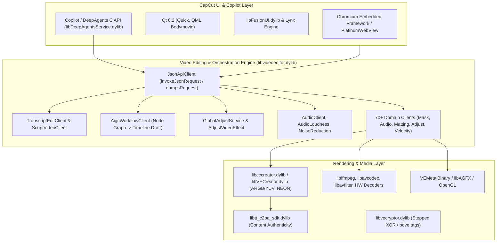

# Video Editing & Effects Plan: CapCut Analysis & Implementation Roadmap

## Goal Description
Perform a deep reverse-engineering analysis of `/Applications/CapCut.app` using REA and binary/bundle inspection tools, dissecting its native architecture, agent copilot system, data structures, and editing pipelines. From these empirical findings, identify concrete opportunities to leverage and cross-pollinate concepts across `@pixerate/editor` packages (`core`, `react`, `svelte`), and formulate an actionable implementation plan.

This plan integrates directly with `@pixerate/editor`'s latest architecture, specifically the newly introduced **Effects Authoring Editor** (`@pixerate/editor/effects`, `EffectAuthoringSession`, `EffectAuthoringEditor`), keyframe animation system (`@pixerate/editor/animation`), and color & gradient subsystems (`@pixerate/editor/color`, `@pixerate/editor/gradient`).


## Implementation Status

Everything in **section 4 (Proposed Changes)** is built natively in this library. Nothing calls,
embeds or depends on CapCut: the analysis above only informed which capabilities to build. Where
the plan conflicted with the code, the code won; the deviations are listed below.

| Plan item | Status | Where |
| :--- | :--- | :--- |
| Adjustment clips with scope (`all` / `underneath` / `track`) | Built | `VideoAdjustmentClip` (`types.ts`), `evaluate.ts` (group layer of the pictures in scope), canvas and SVG through the compound path in `render.ts`, ffmpeg in `export.ts`, `add_video_adjustment_clip`, `<VideoTransport>` Adjustment button, `<ClipInspector>` scope rows |
| Adjustment clips in the effect authoring editor, keyframe alignment with `@pixerate/editor/animation` | Built | `effect-authoring.ts` (`openVideoClipEffectAuthoring`, `videoClipEffectDocument`, `videoEffectValuesFromDocument`, ease conversion both ways), `<VideoEffectsPanel>` author button in React and Svelte |
| `VideoClipMask` (shape, position, size, rotation, feather, corner radius, invert) | Built | `mask.ts`, `evaluate.ts`, `render.ts`, `set_video_clip_mask` / `remove_video_clip_mask`, `<ClipInspector>` mask rows |
| Skin-tone protection for grades and LUTs | Built (on the LUT) | `preserveSkinTones` on `VideoGradeLut`, `videoSkinToneWeight` (`lut.ts`), `applyVideoLutToPixels`, `applyVideoGrade`, `set_video_skin_protection`, `preserve_skin_tones` on `set_video_lut`, `<ClipInspector>` Protect skin |
| `speedCurve` (Bezier speed ramping) | Already in the code | `VideoMediaClip.timeRemap` with eased keys (`remap.ts`, `set_video_speed_ramp`); no second field added |
| `VideoEditPlan` | Built | `plan.ts` (`planVideoEdits`, `diffVideoProjects`, `describeVideoEditPlan`), controller `proposePlan` / `applyPlan` / `discardPlan` / `planPreview` / `isPlanStale`, `state.plans` |
| Audio ducking keyframes | Built | `mix.ts` (`videoSpeechRanges`, `videoDuckingKeys`), `duck_video_music` |
| Loudness gain to a target (-14 LUFS) | Built | `mix.ts` (BS.1770 K-weighting and gating, `measureVideoLoudness`, `videoAudioLoudness`, `videoLoudnessGain`), `VideoAudioPeaks.loudness`, `measure_video_loudness`, `normalize_video_loudness` |
| `createTranscriptEditPlan`, `detectTranscriptDisfluencies` | Built (renamed) | `detectVideoDisfluencies`, `findVideoRepetitions`, `videoCutsWithMargin` (`transcript.ts`); plans come from `TranscriptVideoController.planCleanup` / `deleteSelection({ plan: true })` and `plan_video_dialogue_cleanup` |
| `TranscriptVideoController` | Built | `transcript-controller.ts` |
| Skills `pixerate-talking-head-edit`, `pixerate-bgm-alignment` | Built | `packages/core/skills/`, mapped in `tests/agent-skills.test.ts` |
| Tools `plan_video_edits`, `apply_video_edit_plan`, `find_video_disfluencies`, `duck_background_music`, `add_adjustment_clip`, `set_video_clip_mask` | Built (some renamed) | See the tool list below |
| Beat detection and cuts on the beat (bgm skill) | Built | `findVideoAudioBeats`, `nearestVideoBeat` (`mix.ts`), `find_video_beats`, `plan_video_beat_snap` |
| `TranscriptEditor`, `EditPlanPreview` in React and Svelte | Built | `packages/react/src/video-editor/`, `packages/svelte/src/video-editor/` |
| Demo | Built | Video tab registers the dialogue and music providers; new agent script "video-night-look" (adjustment clip, mask, plan, apply) |

**Tools added.** Main video provider (`createVideoEditorToolProvider`, skill `pixerate-video-editor`):
`add_video_adjustment_clip`, `set_video_clip_mask`, `remove_video_clip_mask`,
`set_video_skin_protection`, `plan_video_edits`, `list_video_edit_plans`, `apply_video_edit_plan`,
`discard_video_edit_plan`, plus `preserve_skin_tones` on `set_video_lut`. Dialogue provider
(`createVideoDialogueToolProvider`, skill `pixerate-talking-head-edit`): `find_video_disfluencies`,
`plan_video_dialogue_cleanup`. Music provider (`createVideoMusicToolProvider`, skill
`pixerate-bgm-alignment`): `find_video_beats`, `plan_video_beat_snap`, `duck_video_music`,
`measure_video_loudness`, `normalize_video_loudness`.

**Deviations from the plan (the code wins).**

- The clip type union already has `media | text | color | sequence | effect`; there are no `video`,
  `audio`, `image` or `title` clip types. The adjustment clip is a sixth type, `adjustment`, and
  extends the shared clip base, so it has fades, opacity, blend, grade, effects and mask like any clip.
- Its target is `targetTrack`, not `targetTrackId`: clip fields are spread next to `track` in tool
  results, and the project's ids have no `Id` suffix. Scope names are `underneath`, `all` and `track`.
- `VideoColorGrade` and `VideoLutRef` do not exist. Skin protection is `preserveSkinTones` on the
  grade's LUT (`VideoGradeLut`), because the grade's other steps are colour matrices (CSS, SVG and
  ffmpeg filters) that cannot be masked per pixel; the LUT already runs per pixel on the CPU.
- No `speedCurve`: speed ramps already exist as `timeRemap` keys with cubic-bezier eases.
- Tool names follow the `*_video_*` convention: `duck_video_music` (not `duck_background_music`),
  `add_video_adjustment_clip` (not `add_adjustment_clip`). Talking-head and music tools are their
  own providers, so each skill documents exactly its tools.
- `createTranscriptEditPlan` became `TranscriptVideoController.planCleanup` and the dialogue tool:
  a plan needs the controller to keep it, so the pure part is `detectVideoDisfluencies` plus
  `planVideoEdits`.
- ffmpeg exports draw an adjustment clip's grade or full-strength LUT at full opacity over what is
  underneath or the whole frame. Masks, fades, part opacity, blends, transitions and scope `track`
  are refused with a message unless the host passes rendered frames (`renderVideoFrameExact`), as
  provider effects already were. Skin protection is noted, not applied, by `lut3d`.
- Speech recognition is the host's job: transcripts still come in as Whisper JSON, SRT or VTT
  (`parseVideoTranscript`, `set_video_transcript`). No speech-to-text service or voice cloning is
  built in. A pluggable speech-to-text interface was not needed, because every cleanup tool works
  on any attached transcript.

**Not built (section 2 opportunities outside the proposed changes):** kinetic word-by-word
captions, the node-based AIGC workflow, C2PA manifests on export, overdub and voice cloning. They
need product decisions (caption design system, provenance signing keys, a voice model) and are
left for follow-up plans.

**Tests:** `tests/video-adjustment-effects.test.ts`, `tests/video-audio-ducking.test.ts`,
`tests/video-transcript-cleanup.test.ts`, `tests/video-edit-plan.test.ts` (core), plus
`tests/video-production.test.tsx` (React) and `tests/video-production.svelte.test.ts` (Svelte). All
use synthetic samples and transcripts: no media decoding or network.

---

## 1. REA & Shipped Target Evidence

Analysis performed on target `/Applications/CapCut.app/Contents/MacOS/CapCut` (Mach-O universal binary arm64/x86_64, bundle ID `com.lemon.lvoverseas`, v9.5.0):



### Key Target Observations
1. **Unified JSON RPC Client Architecture (`JsonApiClient` & `lyra` Structs)**:
   - `libvideoeditor.dylib` encapsulates editing logic into over 70 domain clients (`TranscriptEditClient`, `ScriptVideoClient`, `AigcWorkflowClient`, `MaskClient`, `AudioClient`, `VelocityClient`, etc.).
   - All client calls can be driven via serialized JSON through `JsonApiClient::invokeJsonRequest` and dumped via `JsonApiClient::dumpsRequest`.
2. **Deep Agents AI Copilot Subsystem (`libDeepAgentsService.dylib` & `builtin_skills`)**:
   - Ships a dedicated Agent runtime (`da_agent_create`, `da_agent_execute_subagent`, `da_agent_get_conversation_execution_graph`, `da_session_rewrite_history`).
   - Integrated API endpoints: `/agent_edit_api/query_skills`, `/agent_edit_api/retrieve_tools`, `/agent_edit_api/run_draft_modify_intent`, `/agent_edit_api/plan_generation`.
   - Ships built-in agent skills directly in `/Contents/Resources/builtin_skills/` (`jianying.agent.highlight`, `jianying.agent.material_understanding`, `jianying.agent.script`, `jianying.agent.speaker`, `jingying.agent.align_bgm_with_video`, `jingying.agent.lvc`).
   - Core philosophy: **"默认只出剪辑方案不落轨"** (Default to generating candidate editing proposals with user preview; do not commit changes to timeline tracks without explicit user review).
3. **Transcript-Based Dialogue Editing (`TranscriptEditClient`)**:
   - Bi-directional synchronization between spoken transcripts (ASR words, sentences, paragraphs) and timeline clips.
   - Fine-grained disfluency removal: filler words ("去水词"), speech pauses ("去停顿"), repetitive stutter ("去重复").
   - Voice cloning & text overdubbing (`applyOverdubResult`, `replaceOverdubSentence`).
4. **Comprehensive Effects Architecture (`GlobalAdjustService` & `KFType`)**:
   - **Adjustment Tracks with Flexible Scope**: Global video effects (`AddGlobalVideoEffectReqStruct`) support `setGlobalVideoEffectApplyScope` (`all` tracks, `main` track only, or specific layer index via `adjustGlobalVideoEffectRenderIndex`).
   - **LUTs with Skin Tone Protection**: CapCut's color grading pipeline binds skin segmentation (`skin_seg` in `lut/algorithmConfig.json`) to protect human facial tones (`KFTypeLUTSkin`, `materialIsVaildToUseLut`) while applying heavy creative LUTs.
   - **Audio Effects & Normalization**: Integrated `AudioLoudnessUnify` (-14 LUFS auto-gain), spectral `NoiseReductionService`, and automatic dialogue ducking.
5. **Node-Based AIGC Workflow Pipeline (`AigcWorkflowClient`)**:
   - Visual nodes (`addWorkflowUploadNode`, `addWorkflowGenerateNode`, `updateWorkflowOutputNodes`) connected directly to timeline drafts (`buildDraftFromWorkflow`, `bindWorkflowOutputsToDraft`).
6. **Kinetic Typography & Constraint Layout (`aigc_text_template`)**:
   - Constraint-based layout (`bottom_toBottomOf`, `hCenter_toHCenterOf`, `fix_dimensionRatio`), 3D transforms (`position`, `rotation`, `scale`), SDF text rendering, rounded canvas badges, and word-by-word animation sequences (`addLyricEffect`).
7. **Curves, Velocity & Parametric Masks**:
   - Bezier curve speed ramping (`VelocityClient`), motion blur synthesis (`MotionBlurClient`), and unified parametric featherable masks (`_VKFFCommonMask*`).
8. **Content Provenance & Authenticity (`libtt_c2pa_sdk.dylib`)**:
   - Native integration of the C2PA specification for cryptographic provenance of AI-generated and edited media.

---

## 2. Identified Opportunities & Synergy with `@pixerate/editor`

The concepts in `@pixerate/editor` are exceptionally well-positioned to both learn from CapCut and solve problems more elegantly:

| CapCut Concept / Finding | `@pixerate/editor` Synergy & Package | Opportunity for `@pixerate/editor` |
| :--- | :--- | :--- |
| **Adjustment Tracks & Effect Scope** (`AddGlobalVideoEffectReqStruct`, `setGlobalVideoEffectApplyScope`) | `@pixerate/editor/video-editor` (`effects.ts`, `evaluate.ts`) + `@pixerate/editor/effects` (`EffectAuthoringSession`) | **Timeline Adjustment Tracks & Layers**: Non-destructive adjustment clips spanning time ranges across tracks with configurable `applyScope` (`'all'` composite, `'underneath'` layers only, or `'track'`). Editable via the dedicated effects editor. |
| **Skin-Protected Color Grading** (`KFTypeLUTSkin`, `skin_seg` pipeline) | `@pixerate/editor/video-editor/lut.ts` + `grade.ts` + `@pixerate/editor/color` | **Skin-Tone Guarded LUTs**: Allow color grading and 3D LUT passes to preserve natural skin chroma and facial hues via a configurable skin-protection slider. |
| **Audio Loudness & Auto-Ducking** (`AudioLoudnessUnify`, `NoiseReductionService`) | `@pixerate/editor/video-editor/audio.ts` | **Automatic BGM Ducking & Loudness Leveler**: Automatically generate ducking volume keyframes on music tracks when dialogue occurs; normalize clip audio to broadcast standards (-14 LUFS). |
| **Kinetic Typography & Lyric Effects** (`addLyricEffect`, `aigc_text_template`) | `@pixerate/editor/animation-editor` + `@pixerate/editor/text` + `rich-text` | **Animated Kinetic Captions**: Synchronized word-by-word animation presets (bounce, karaoke highlight sweep, typewriter) tied to ASR timestamps. |
| **Transcript-based editing** (`TranscriptEditClient`) | `@pixerate/editor/text` (TipTap rich text) + `@pixerate/editor/video-editor` (`transcript.ts`) | **Interactive Transcript Editor Component**: Rich text document representing spoken dialogue where typing, deleting, reordering paragraphs, or striking through text drives non-linear video cuts and trims in real-time. |
| **"Plan-First Candidate Preview"** ("默认只出剪辑方案不落轨") | `@pixerate/editor/commands`, `agent`, `history`, `video-editor` | **Proposed Edit Previews (Dry-Run Timeline Diffs)**: Allow agents and users to generate structured editing proposals (`VideoEditPlan`) with visual timeline diffs before committing them as history steps. |
| **Specialized Video Agent Skills** (`builtin_skills/`) | `packages/core/skills/` & `packages/core/src/agent` | **Dedicated Agent Skills for Common Video Workflows**: Add skills for talking-head cleanup, beat-matched BGM alignment, video highlights, and long-to-short condensation. |
| **Parametric Featherable Masks** (`_VKFFCommonMask*`) | `@pixerate/editor/raster` + `@pixerate/editor/vector` + `@pixerate/editor/effects` | **Clip Masks & Cutout Layers**: Featherable parametric shape masks (rectangle, circle, linear split, freeform polygon) with corner radius and invert toggles. |
| **Non-linear Velocity Curves** (`VelocityClient`) | `@pixerate/editor/animation-editor` + `@pixerate/editor/video-editor` | **Bezier Speed Ramping**: Continuous Bezier easing curves for video clip playback speed using `@pixerate/editor/animation` curves. |
| **C2PA Content Provenance** (`libtt_c2pa_sdk.dylib`) | `@pixerate/editor/generation/provenance.ts` + `@pixerate/editor/export` | **Standardized C2PA Manifest Export**: Extend generation provenance into C2PA-compliant assertion metadata on exported media. |

---

## 3. Architecture & Integration with the Effects Editor

`@pixerate/editor` recently added a dedicated effect authoring subsystem:
- `EffectAuthoringSession` (`packages/core/src/effects/authoring-session.ts`): provides uniform value inspection, preset management, keyframing, timeline animation, and undo/redo over any effect provider.
- `EffectAuthoringEditor` in React and Svelte: provides high-level UI for tuning shader parameters, scrubbing effect timelines, and saving presets.

### Integration Points:
1. **Adjustment Clips as Effect Authoring Targets**:
   - An adjustment clip (`VideoAdjustmentClip`) on the video timeline contains an effect stack. Selecting an adjustment clip on the video timeline can directly mount or open the `EffectAuthoringEditor` with that clip's active effect, providing keyframing and parameter controls out of the box.
2. **Keyframe Alignment**:
   - The effect authoring session uses `AnimationTrack` and `AnimationKeyframe` from `@pixerate/editor/animation`. Video clip animation tracks in `packages/core/src/video-editor/clip-animation.ts` and adjustment layer effect keyframes share identical interpolation and evaluation semantics.
3. **Color & LUT Grading Consistency**:
   - Skin-tone protection and color grading sliders align with `@pixerate/editor/color` (`parseColor`, gamut validation, and HSL/OKLCH color conversion).

---

## 4. Proposed Changes

### Component 1: `core/video-editor` — Effects Architecture & Timeline Adjustment Tracks

#### [MODIFY] `packages/core/src/video-editor/types.ts`
- Add `VideoAdjustmentClip`:
  ```typescript
  export interface VideoAdjustmentClip {
    id: string;
    type: 'adjustment';
    start: number; // timeline ms
    duration: number; // timeline ms
    applyScope?: 'all' | 'underneath' | 'track';
    targetTrackId?: string;
    effects: VideoClipEffect[];
  }
  ```
- Extend `VideoClip` to allow `type: 'adjustment' | 'effect' | 'video' | 'audio' | 'image' | 'title'`.
- Add `VideoClipMask` interface for parametric shape masks (shape, position, size, rotation, feather, cornerRadius, inverted).
- Add `preserveSkinTones?: number` (0 to 1) to `VideoColorGrade` and `VideoLutRef`.
- Add `speedCurve` property to `VideoClip` using cubic Bezier control points (`AnimationEasing`).
- Add `VideoEditPlan` interface for proposed edits.

#### [MODIFY] `packages/core/src/video-editor/evaluate.ts` & `packages/core/src/video-editor/effects.ts`
- Support adjustment layers in `evaluateVideoTimeline`: when an adjustment clip is active at `time`, wrap the underlying evaluated layer stack in the adjustment clip's effect pipeline.
- Implement skin tone chroma protection logic in `lut.ts` / `grade.ts`.

#### [MODIFY] `packages/core/src/video-editor/audio.ts`
- Add `generateAudioDuckingKeyframes`: inspects speech intervals on dialogue tracks and generates smooth volume attenuation keyframes (e.g. -14dB with 200ms ease-in/out) on BGM tracks.
- Add `calculateLoudnessGain`: computes RMS/peak normalization factor to hit target loudness (e.g. -14 LUFS).

---

### Component 2: `core/video-editor` — Proposed Edits & Interactive Transcript Controller

#### [MODIFY] `packages/core/src/video-editor/transcript.ts`
- Add `createTranscriptEditPlan`: converts text-level deletions, insertions, or splits into a `VideoEditPlan`.
- Add `detectTranscriptDisfluencies`: detects filler words ("um", "uh", "like"), pauses exceeding a threshold, and repetitive word sequences.

#### [NEW] `packages/core/src/video-editor/transcript-controller.ts`
- Implements `TranscriptVideoController`: bi-directional coordination between text caret/selection positions and timeline seek head, propagating text edits into timeline clip trims and splits.

---

### Component 3: `core/skills` & `core/src/agent` — Domain Agent Skills & Tools

#### [NEW] `packages/core/skills/pixerate-talking-head-edit/SKILL.md`
- Guide for autonomous agents on how to perform smart dialogue cleanup:
  1. Parse transcript words and timestamps.
  2. Detect filler words, unnatural pauses (>600ms), and repeated phrases.
  3. Formulate a `VideoEditPlan` keeping 150-250ms audio breath margins around cuts.
  4. Preview and execute the batch cut using `edit_video`.

#### [NEW] `packages/core/skills/pixerate-bgm-alignment/SKILL.md`
- Guide for aligning music tracks to video cuts and applying audio ducking:
  1. Detect musical beats and downbeats.
  2. Snap video cut points to nearest beat markers ("卡点").
  3. Apply audio ducking (-14dB to -18dB) under active speech dialogue.
  4. Set smooth exponential or S-curve fade-outs at the project outro.

#### [MODIFY] `packages/core/src/video-editor/tools.ts`
- Add agent tools:
  - `plan_video_edits`: generates a `VideoEditPlan` without mutating the project.
  - `apply_video_edit_plan`: commits a proposed plan into the project history.
  - `find_video_disfluencies`: detects filler words, pauses, and repetitions in dialogue.
  - `duck_background_music`: automatically generates ducking keyframes on music tracks under speech.
  - `add_adjustment_clip`: inserts an adjustment clip with effects spanning a timeline range.
  - `set_video_clip_mask`: configures a featherable mask on a clip.

---

### Component 4: `packages/react` & `packages/svelte` — UI Parity

#### [NEW] `packages/react/src/video-editor/TranscriptEditor.tsx` & `packages/svelte/src/video-editor/TranscriptEditor.svelte`
- Interactive dialogue transcript panel with word-level highlight tracking during playback.
- Visual chips for detected filler words and pause intervals with one-click excision.

#### [NEW] `packages/react/src/video-editor/EditPlanPreview.tsx` & `packages/svelte/src/video-editor/EditPlanPreview.svelte`
- Diff preview banner displaying summary of proposed cuts (duration delta, excised segments) with "Accept Plan" and "Discard" actions.

---

## 5. Verification Plan

### Automated Tests
1. **Adjustment Track & Effect Scoping**:
   ```bash
   pnpm --filter @pixerate/editor test tests/video-adjustment-effects.test.ts
   ```
2. **Audio Ducking & Loudness Normalization**:
   ```bash
   pnpm --filter @pixerate/editor test tests/video-audio-ducking.test.ts
   ```
3. **Transcript & Disfluency Detection**:
   ```bash
   pnpm --filter @pixerate/editor test tests/video-transcript-cleanup.test.ts
   ```
4. **Edit Plan Generation & Application**:
   ```bash
   pnpm --filter @pixerate/editor test tests/video-edit-plan.test.ts
   ```
5. **Agent Skills & Tools Conformance**:
   ```bash
   pnpm --filter @pixerate/editor test tests/agent-skills.test.ts
   pnpm --filter @pixerate/editor test tests/command-tools.test.ts
   ```
6. **Full Workspace Build & Typecheck**:
   ```bash
   pnpm build
   pnpm test
   pnpm --filter demo build
   ```

### Manual Verification
1. Open the demo app (`pnpm --filter demo dev`).
2. Add an Adjustment Clip with a Color Grade/LUT and verify it affects all layers underneath across its timeline range.
3. Test opening the selected Adjustment Clip in the `EffectAuthoringEditor` tab to keyframe and tune its shader parameters.
4. Test BGM audio ducking when dropping music underneath a spoken clip.
5. Test dialogue cleanup in `TranscriptEditor` and check that the proposed `VideoEditPlan` cleanly updates the timeline.
