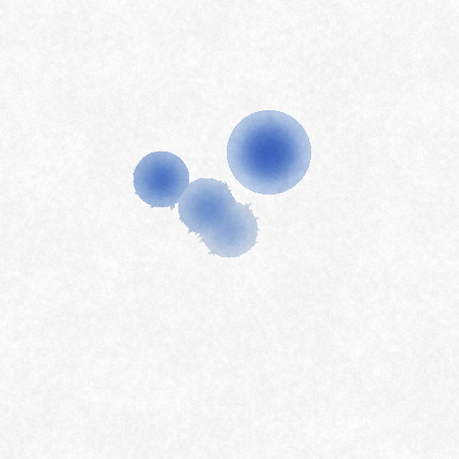
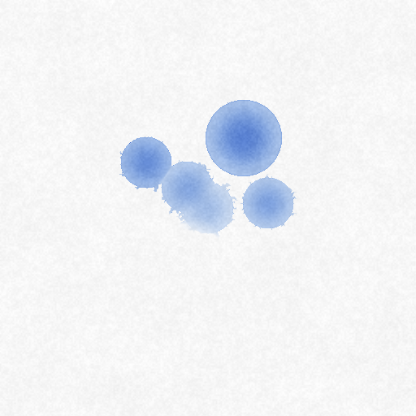

# Wet media spike: WebGPU vs WebAssembly SIMD vs TypeScript

**Status:** spike, not for release. Nothing here is imported by `packages/`. Measured 2026-10-19.

**Question:** how should the paint editor's wet media (watercolour first) run in the browser?

## Recommendation: hybrid, with the CPU as the authority

1. **Build the WebAssembly SIMD engine first and treat it as the reference.** It runs in Web Workers on 256 px tiles and works in every browser with cross-origin isolation. It owns drying, save, export and any stroke replay. Its results were bit-identical with 1 and 14 workers, and between Chrome 156 and Safari 27.
2. **Add WebGPU second, as an accelerator for big wet areas.** It's 2.0–2.7× faster than wasm on large washes on this M4 Pro. It also keeps the CPU almost idle: the renderer used about 1–7% CPU, against 700–1050% for wasm. Turn it on when `navigator.gpu` is present and the wet area is large. Results stay within 1/255 of the CPU, but they are not bit-identical, even between two browsers on the same GPU.
3. **Plain TypeScript is for tests and Node only.** It's 60–120× slower than wasm with workers, and about 9× slower than one wasm worker. A dab takes 50–1400 ms to show up, which is unusable for painting.

The hint from Rebelle (OpenMP + Highway) and Corel Painter (AVX2 LBM builds) holds up. A SIMD CPU lattice Boltzmann watercolour is fast enough to paint with on its own. On this machine, wasm SIMD sustains ≥ 120 steps/s (two steps per 60 Hz frame) for every case up to a fully wet 2048² canvas, and for 4096² at 10% wet. It runs 99 steps/s at 4096² 50% wet. It's too slow only for a fully wet 4096² sheet (37 steps/s). WebGPU reaches 101 steps/s there.

So the CPU path isn't a "low resolution fallback", and it's needed anyway: dry painting must work without a GPU, and save has to dry deterministically. WebGPU is worth having for headroom, battery and very large washes. It shouldn't be the only engine, and it shouldn't be the source of truth.

Why not GPU-first with a CPU fallback? The two cost about the same to build, since both kernels are needed either way. The difference is which one defines the result. With GPU-first, the saved painting depends on the shader compiler and GPU vendor. Chrome's Tint and Safari's compiler already give different bits on the same Apple GPU. The CPU result is reproducible everywhere.

Why not CPU-only? On this Mac the CPU path keeps 10 cores busy while paint is wet, and it falls behind on full-sheet 4096² washes. Lower-end machines have fewer cores (see the scaling table) and would hit the limit sooner. With WebGPU accepted, it's the cheap way to buy headroom.

## What was built

All of it is in `spikes/wet-media/`:

| File | What |
|---|---|
| `src/model.ts` | Parameters, D2Q9 constants, paper grain (seeded value noise), flow map, display shading, the `WetSim` interface |
| `src/ts-sim.ts` | **Reference.** `stepTile` defines the model: one pass per cell over dense `Float32Array` planes |
| `assembly/step.ts` | AssemblyScript port of `stepTile`, 4 cells per `f32x4`, on 258² tile slots (256 + 1-cell halo) |
| `src/wasm-layout.ts`, `src/wasm-worker.ts`, `src/wasm-sim.ts` | One shared `WebAssembly.Memory`. Workers take tiles from an atomic counter, then barrier, grow the tile set, exchange halos, and barrier again |
| `src/gpu/step.wgsl`, `edit.wgsl`, `display.wgsl`, `src/gpu-sim.ts` | WGSL port. Dense storage buffers, ping-ponged bind groups, `dispatchWorkgroups(16, 16, activeTiles)`, per-tile wet flags read back asynchronously |
| `src/active.ts` | Grow-only active tile set, shared by all three |
| `src/main.ts`, `index.html` | Vite page: interactive painting (`/`), plus `?mode=bench|latency|diverge|scaling|readback` |
| `scripts/run-bench.mjs` | Drives Chrome with Playwright. Samples `ps` (per Chrome process) and `ioreg` GPU utilisation |
| `scripts/summarize.mjs` | Turns `results/*.json` into the tables below |

Run it:

```bash
pnpm install --ignore-workspace && pnpm dev   # http://localhost:5199, paint with the mouse
pnpm bench && pnpm summarize                  # full matrix, about 25 min
```

### The model (from the literature only)

- **Water.** A D2Q9 lattice Boltzmann model with BGK collision, τ = 3ν + 0.5. Streaming uses partial bounce-back with a per-cell blocking factor, taken from the paper grain: κ = (1 − permeability)·h. The blocking between two cells is b = max(κₓ, κₙ). b = 1 at the canvas edge, and also when the wet front is *pinned*: one side is dry and the other is shallower than a threshold that rises with grain roughness. That's the scheme in Chu & Tai, *MoXi: Real-Time Ink Dispersion in Absorbent Paper* (SIGGRAPH 2005). b is symmetric, so water is conserved exactly. The table below shows drift of 1e-9 to 4e-6 over 300 steps.
- **Forcing.** Tilt plus an optional flow map, applied as a velocity shift (u += τ·g), with |u| capped at 0.25 cells per step.
- **Paper.** Absorption fills each cell's paper capacity, and evaporation is stronger where the wet area meets dry cells (edge darkening, as in Curtis et al., *Computer-Generated Watercolor*, SIGGRAPH 1997).
- **Pigment.** Advected with a first-order **upwind finite-volume** flux, using the previous step's velocities scaled by mobility (1 − weight/2). I chose this over semi-Lagrangian advection on purpose. It conserves pigment, has no gathers (so it vectorises), and with |u| ≤ 0.25 it is CFL-stable and never goes negative.
- **Deposition and lift.** Deposition is boosted in grain valleys, which gives granulation. Pickup lifts deposit back into clear water. On drying, all suspended pigment settles.
- **Parameters exposed.** Wetness and concentration (per dab), viscosity, evaporation, edge evaporation, pigment weight, pickup rate, fixture rate, paper absorption, capacity, permeability and roughness (all from the grain height map), pin threshold, tilt x/y, and flow-map strength.

| Wet, step 100 | Wet, step 300 | Dried, step 500 (TS) | Dried, step 500 (WebGPU) |
|---|---|---|---|
|  |  |  |  |

These are a 512² test: 4 dabs at step 0, a clear-water dab at step 150 (it lifts pigment), and another dab at step 300, with tilt and a swirl flow map. The look isn't tuned (edge darkening is mild). This spike is about cost, and tuning the look doesn't change the cost.

### Why AssemblyScript, not Rust

Rust and `wasm-pack` aren't installed on this machine. AssemblyScript is an npm dev dependency, set up in one line with no toolchain download. Its `v128` / `f32x4` intrinsics map one-to-one onto wasm `simd128`, and it supports `--sharedMemory --importMemory` for threads. The kernel is straight-line SIMD with explicit instructions, so the output doesn't depend on an auto-vectoriser. Rust's `core::arch::wasm32` would produce essentially the same instructions; LLVM might schedule them a little better. For production I'd still consider Rust for the wider ecosystem, but the AssemblyScript build is 5 KB of wasm with no extra dependencies, which also suits this repo.

## Method

- **Machine.** Apple M4 Pro (10 performance + 4 efficiency cores, 24 GB unified memory), macOS 27.
- **Chrome.** **Chrome for Testing 156.0.8078.4** (Playwright's build; Google Chrome itself isn't installed), headed, default flags. **Safari 27.0.1** was used for a cross-check, opened with `open -a Safari …&report=1`.
- **WebGPU adapter.** `apple metal-3`. Its limits allow 4 GiB storage bindings and 10 storage buffers per stage. The step uses 9.
- Each configuration ran on a fresh page with a fresh context.
- **Wet area.** "X% wet" means a tile-aligned block of about X% of the tiles. It's washed with an 80 px inset (so no neighbouring tile wakes up) and stirred with 64 px dabs every 128 px. The tables give the number of tiles actually dispatched.
- **Steps per second.** The median over batches of about 250 ms, after 8 warm-up steps, for a budget of 4 s. TS at 4096² ran far fewer steps.
- **wasm workers.** wasm uses `hardwareConcurrency` workers: 14 in Chrome, 8 in Safari, which caps the reported value.
- **Dab to pixels.** Time from `dab()` through one step and presenting the dab's tiles until the pixels are committed. For WebGPU that's `onSubmittedWorkDone`; for CPU paths it's `putImageData`. A compositor frame (≤ 8–17 ms) comes on top. Each run does 9 dabs on fresh paper, and the first one includes allocation.
- **Load.** CPU % of the renderer and GPU processes (`ps`), and Apple GPU *Device Utilization %* (`ioreg`), sampled every 0.4 s while stepping. Benchmarks run flat out, so the GPU shows about 99% by design. A real editor would cap the steps per frame.
- **Memory.** "Sim state" is the analytic size of the buffers each path allocates. Process RSS is shown too. WebGPU buffers live in IOKit memory, which doesn't show up in the GPU process RSS.

## Results

### Steps per second

| Canvas | Wet (tiles dispatched) | WebGPU | wasm SIMD | TypeScript | GPU ÷ wasm |
|---|---|---|---|---|---|
| 1024² | 10% (2/16) | 25937 (0.04 ms) | 1526 (0.66 ms) | 87 (11.43 ms) | 17.0× |
| 1024² | 50% (8/16) | 3285 (0.30 ms) | 1196 (0.84 ms) | 21 (46.94 ms) | 2.7× |
| 1024² | 100% (16/16) | 1626 (0.61 ms) | 659 (1.52 ms) | 11 (91.20 ms) | 2.5× |
| 2048² | 10% (6/64) | 4681 (0.21 ms) | 1301 (0.77 ms) | 28 (36.30 ms) | 3.6× |
| 2048² | 50% (32/64) | 807 (1.24 ms) | 344 (2.91 ms) | 5.04 (198.37 ms) | 2.3× |
| 2048² | 100% (64/64) | 402 (2.49 ms) | 185 (5.41 ms) | 2.65 (377.50 ms) | 2.2× |
| 4096² | 10% (25/256) | 1006 (0.99 ms) | 432 (2.32 ms) | 4.42 (226.36 ms) | 2.3× |
| 4096² | 50% (128/256) | 198 (5.05 ms) | 99 (10.15 ms) | 0.83 (1208.80 ms) | 2.0× |
| 4096² | 100% (256/256) | 101 (9.85 ms) | 37 (27.01 ms) | 0.40 (2502.16 ms) | 2.7× |

### Cell throughput (million cell-steps per second, active cells only)

| Canvas | Wet | WebGPU | wasm SIMD | TypeScript |
|---|---|---|---|---|
| 1024² | 10% | 3400 | 200 | 11 |
| 1024² | 50% | 1722 | 627 | 11 |
| 1024² | 100% | 1705 | 691 | 11 |
| 2048² | 10% | 1841 | 511 | 11 |
| 2048² | 50% | 1692 | 721 | 11 |
| 2048² | 100% | 1686 | 775 | 11 |
| 4096² | 10% | 1648 | 707 | 7 |
| 4096² | 50% | 1661 | 826 | 7 |
| 4096² | 100% | 1703 | 621 | 7 |

The wasm 1024²/10% row is low because only 2 tiles exist for 14 workers. Splitting a tile into row bands would fix that. The GPU 1024²/10% row is cache-resident and dispatch-bound. At scale, WebGPU is **bandwidth-bound at about 1.7 G cell-steps/s**: roughly 110 B per cell-step, about 190 GB/s against about 270 GB/s peak. wasm reaches 0.6–0.8 G cell-steps/s on 10 performance cores.

### Memory and load while stepping

| Run | Sim state (MB) | Renderer RSS max (MB) | GPU-process RSS max (MB) | Renderer CPU avg % | GPU-process CPU avg % | GPU util avg / max % |
|---|---|---|---|---|---|---|
| WebGPU 1024² 10% | 120 | 460 | 165 | 7 | 21 | 98 / 98 |
| WebGPU 1024² 50% | 120 | 451 | 158 | 6 | 13 | 99 / 99 |
| WebGPU 1024² 100% | 120 | 452 | 155 | 5 | 9 | 99 / 99 |
| WebGPU 2048² 10% | 480 | 475 | 168 | 6 | 12 | 98 / 99 |
| WebGPU 2048² 50% | 480 | 475 | 173 | 3 | 6 | 99 / 99 |
| WebGPU 2048² 100% | 480 | 476 | 165 | 2 | 5 | 99 / 100 |
| WebGPU 4096² 10% | 1920 | 352 | 138 | 3 | 7 | 99 / 99 |
| WebGPU 4096² 50% | 1920 | 572 | 210 | 1 | 4 | 99 / 99 |
| WebGPU 4096² 100% | 1920 | 573 | 208 | 1 | 4 | 99 / 99 |
| wasm SIMD 1024² 10% | 20 | 529 | 135 | 230 | 1 | 13 / 15 |
| wasm SIMD 1024² 50% | 67 | 577 | 136 | 665 | 1 | 13 / 16 |
| wasm SIMD 1024² 100% | 130 | 634 | 137 | 816 | 1 | 13 / 17 |
| wasm SIMD 2048² 10% | 63 | 587 | 137 | 529 | 1 | 12 / 14 |
| wasm SIMD 2048² 50% | 268 | 780 | 135 | 947 | 2 | 13 / 15 |
| wasm SIMD 2048² 100% | 520 | 1023 | 133 | 964 | 2 | 13 / 14 |
| wasm SIMD 4096² 10% | 261 | 863 | 133 | 902 | 1 | 12 / 13 |
| wasm SIMD 4096² 50% | 1072 | 1626 | 126 | 1048 | 1 | 12 / 13 |
| wasm SIMD 4096² 100% | 2079 | 2241 | 91 | 743 | 0 | 35 / 42 |
| TypeScript 1024² 10% | 116 | 482 | 112 | 100 | 2 | 20 / 23 |
| TypeScript 1024² 50% | 116 | 514 | 116 | 99 | 2 | 17 / 21 |
| TypeScript 1024² 100% | 116 | 565 | 113 | 99 | 2 | 16 / 19 |
| TypeScript 2048² 10% | 464 | 636 | 112 | 98 | 2 | 18 / 24 |
| TypeScript 2048² 50% | 464 | 690 | 115 | 98 | 1 | 19 / 41 |
| TypeScript 2048² 100% | 464 | 918 | 115 | 100 | 1 | 20 / 22 |
| TypeScript 4096² 10% | 1856 | 1078 | 115 | 100 | 2 | 17 / 18 |
| TypeScript 4096² 50% | 1856 | 1278 | 107 | 99 | 1 | 19 / 28 |
| TypeScript 4096² 100% | 1856 | 2192 | 102 | 99 | 0 | 16 / 18 |

Adapter: apple metal-3; limits {"maxStorageBufferBindingSize":4294967292,"maxBufferSize":4294967292,"maxStorageBuffersPerShaderStage":10}

The state costs **120 B per cell on the GPU** (dense, regardless of how much is wet) and **126 B per active cell for wasm** (31 f32 planes on 258² slots, allocated only for wet tiles). An RGBA8 raster tile costs 4 B per cell, so the wet layer is about 30× the size of the paint it produces. That's why wet state must be sparse and short-lived. On the GPU, a 4096² canvas holds 1.9 GB however little of it is wet. A production GPU path should use a tile atlas (256² slots plus an indirection table) like the wasm slots.

### Dab to pixels (64 px dab, then 1 step, then present the dab tiles)

| Impl | Canvas | Rest of canvas | First dab (ms) | Median of next 8 (ms) | Max (ms) |
|---|---|---|---|---|---|
| WebGPU | 1024² | dry | 5.9 | 2.5 | 338.9 |
| WebGPU | 1024² | 50% wet (14 tiles active at end) | 1.6 | 1.8 | 3.8 |
| WebGPU | 2048² | dry | 13.1 | 2.7 | 3.3 |
| WebGPU | 2048² | 50% wet (48 tiles active at end) | 3.3 | 3.7 | 4.7 |
| WebGPU | 4096² | dry | 228.1 | 12.5 | 44.4 |
| WebGPU | 4096² | 50% wet (164 tiles active at end) | 10.3 | 13.4 | 36.0 |
| wasm SIMD | 1024² | dry | 11.5 | 3.5 | 7.4 |
| wasm SIMD | 1024² | 50% wet (14 tiles active at end) | 5.3 | 3.7 | 5.7 |
| wasm SIMD | 2048² | dry | 6.4 | 5.1 | 8.3 |
| wasm SIMD | 2048² | 50% wet (48 tiles active at end) | 6.1 | 7.0 | 10.8 |
| wasm SIMD | 4096² | dry | 8.5 | 6.9 | 7.8 |
| wasm SIMD | 4096² | 50% wet (164 tiles active at end) | 15.2 | 19.4 | 19.6 |
| TypeScript | 1024² | dry | 42.1 | 52.5 | 57.1 |
| TypeScript | 1024² | 50% wet (14 tiles active at end) | 63.5 | 79.1 | 85.6 |
| TypeScript | 2048² | dry | 21.6 | 65.2 | 87.2 |
| TypeScript | 2048² | 50% wet (48 tiles active at end) | 217.1 | 274.9 | 290.7 |
| TypeScript | 4096² | dry | 72.6 | 191.3 | 274.3 |
| TypeScript | 4096² | 50% wet (164 tiles active at end) | 1255.0 | 1409.4 | 1461.8 |

Every WebGPU and wasm case except one is under one 60 Hz frame (16.7 ms): wasm at 4096² with half the canvas wet takes 19 ms. That's one step of 164 tiles, plus shading the dab tiles in JS. The first GPU dab on a fresh 4096² canvas took 228 ms, because the first use of the 1.9 GB of dense buffers faults them in. The single 339 ms outlier at GPU 1024² looks like a one-off pipeline or driver stall. Both should be done at document open, not on the first stroke. The CPU paths shade the display tiles on the main thread in JS, at about 1.1 ms per tile (see below). Moving that into the wasm workers would remove most of the wasm latency.

### wasm worker scaling (2048², 100% wet, 14 logical cores)

| Workers | ms / step | steps / s | speed-up vs 1 |
|---|---|---|---|
| 1 | 41.46 | 24.1 | 1.00× |
| 2 | 21.19 | 47.2 | 1.96× |
| 4 | 11.04 | 90.6 | 3.76× |
| 6 | 7.84 | 127.6 | 5.29× |
| 8 | 6.11 | 163.6 | 6.78× |
| 10 | 5.47 | 182.8 | 7.58× |
| 12 | 5.63 | 177.5 | 7.36× |
| 14 | 5.46 | 183.2 | 7.60× |
| ts | 378.29 | 2.6 | 0.11× |

Scaling is close to linear up to the 10 performance cores (7.6×) and then flat: the efficiency cores add nothing, and memory bandwidth is the next limit. A 4-core laptop should get roughly 4/10 of these numbers, about 90 steps/s at 2048² fully wet.

### Wet layer → RGBA8 raster tiles (2048², fully wet, Chrome)

| Path | Tiles | MB | Median ms |
|---|---|---|---|
| WebGPU (shade + copy + mapAsync) | 1 | 0.25 | 1.1 |
| WebGPU (shade + copy + mapAsync) | 4 | 1 | 1.1 |
| WebGPU (shade + copy + mapAsync) | 16 | 4 | 1.8 |
| WebGPU (shade + copy + mapAsync) | 64 | 16 | 4.4 |
| wasm path (JS shading, main thread) | 1 | 0.25 | 1.1 |
| wasm path (JS shading, main thread) | 4 | 1 | 4.3 |
| wasm path (JS shading, main thread) | 16 | 4 | 17.5 |
| wasm path (JS shading, main thread) | 64 | 16 | 70.3 |

The compositor stays on the CPU, so the GPU path has to hand RGBA8 tiles back. That turned out to be cheap: 64 tiles (16 MB) in 4.4 ms, including shading the whole canvas. On the CPU path, the expensive part is the shading in JS on the main thread, at about 1.1 ms per tile (3 `exp` per pixel). In production it belongs in the SIMD kernel, run in the workers.

### Divergence from the TypeScript reference (512², 500 steps, flow map + tilt, 6 dabs)

| Impl | Step | water max abs | water rel RMS | pigment (suspended) max abs | deposit max abs | RGBA8 wet: max Δ / % px | RGBA8 dried: max Δ / % px |
|---|---|---|---|---|---|---|---|
| wasm SIMD (14 workers) | 100 | 2.9e-6 | 2.6e-6 | 1.1e-6 | 3.4e-7 | 1 / 0.001 | 1 / 0.001 |
| wasm SIMD (14 workers) | 200 | 1.9e-6 | 2.6e-6 | 8.8e-7 | 8.3e-7 | 1 / 0.002 | 1 / 0.002 |
| wasm SIMD (14 workers) | 300 | 1.3e-6 | 2.1e-6 | 7.2e-7 | 1.3e-6 | 1 / 0.001 | 1 / 0.000 |
| wasm SIMD (14 workers) | 400 | 1.2e-6 | 2.7e-6 | 7.3e-7 | 1.6e-6 | 1 / 0.001 | 1 / 0.001 |
| wasm SIMD (14 workers) | 500 | 1.1e-6 | 2.9e-6 | 8.6e-7 | 1.7e-6 | 1 / 0.000 | 1 / 0.000 |
| WebGPU | 100 | 1.4e-6 | 2.2e-6 | 7.5e-7 | 2.5e-7 | 1 / 0.000 | 0 / 0.000 |
| WebGPU | 200 | 1.8e-6 | 3.9e-6 | 4.8e-7 | 8.3e-7 | 1 / 0.001 | 1 / 0.000 |
| WebGPU | 300 | 2.2e-6 | 4.8e-6 | 5.2e-7 | 1.1e-6 | 1 / 0.001 | 1 / 0.000 |
| WebGPU | 400 | 2.3e-6 | 7.8e-6 | 5.2e-7 | 1.2e-6 | 1 / 0.002 | 0 / 0.000 |
| WebGPU | 500 | 2.5e-6 | 1.1e-5 | 7.7e-7 | 1.3e-6 | 1 / 0.001 | 1 / 0.000 |

State hashes at step 500 (FNV-1a of the f32 planes and of the dried RGBA8):

| Run | State | Dried RGBA8 |
|---|---|---|
| TypeScript | `e1c8003f1a5f2236bcc95b4c` | `98a5bbf7` |
| wasm SIMD (14 workers) | `276867b8e97d13108f5c61bb` | `f48456f7` |
| wasm SIMD (1 worker) | `276867b8e97d13108f5c61bb` | `f48456f7` |
| WebGPU | `b662c73e65120a0c488c7b58` | `51e69246` |
| WebGPU | `b662c73e65120a0c488c7b58` | `51e69246` |

Conservation with evaporation and absorption off (300 steps):

| Impl | Water drift | Pigment drift |
|---|---|---|
| TypeScript | 1.2e-9 | -4.5e-9 |
| wasm SIMD (14 workers) | 4.1e-6 | 5.3e-9 |
| WebGPU | 3.4e-6 | 4.4e-10 |

Run time of the 500-step check: TypeScript 16.66 s, wasm SIMD (14 workers) 0.46 s, wasm SIMD (1 worker) 1.34 s, WebGPU 0.18 s, WebGPU 0.18 s

### Safari 27.0.1 cross-check (same Mac)

| Run | Steps/s (ms/step) |
|---|---|
| WebGPU 2048², 100% wet | 369 (2.71 ms) |
| wasm SIMD ×8, 2048², 100% wet | 168 (5.95 ms) |
| WebGPU 4096², 100% wet | 94 (10.67 ms) |
| wasm SIMD ×8, 4096², 50% wet | 73 (13.78 ms) |

The step-500 state hashes in Safari: **TypeScript and wasm match Chrome bit for bit**: TS `e1c8003f1a5f2236bcc95b4c`, wasm `276867b8e97d13108f5c61bb`. **WebGPU doesn't**: Chrome gives `b662c73e…`, Safari `58320f48…`. The hardware is the same, but WGSL is compiled by different compilers (Tint→MSL in Chrome, WebKit's own in Safari). Safari WebGPU is still within the same 1/255 of the reference. Safari's `maxStorageBufferBindingSize` is 2 GiB (Chrome's is 4 GiB), and it reports `hardwareConcurrency` = 8.

## Questions from the brief

### How results diverge over 500 steps

They barely do. Against the TS reference (which computes in f64 and stores f32), wasm and WebGPU stay within **~3e-6 absolute (relative RMS ≤ 1.1e-5)** in water, pigment and deposit. After display or drying, pixels differ by at most **1/255** on **≤ 0.002 %** of them. The model is dissipative (evaporation, deposition, BGK relaxation) and has no chaotic amplification. The discontinuities (pinning, the dry threshold) didn't cause visible forks in this test.

- **Bit-identical within an implementation:** wasm with 1 and 14 workers (work split, halo exchange and order don't matter, because each cell is computed independently), two WebGPU runs on the same browser, and TS and wasm across Chrome and Safari.
- **Not bit-identical:** across the three implementations, and WebGPU across browsers. Expect WebGPU to differ across GPU vendors and driver versions too, since WGSL allows fused multiply-add contraction and approximations in `exp`, `sqrt` and division.

### WebGPU availability today, and what the fallback costs

- **Chrome / Edge:** on by default on Windows, macOS and ChromeOS since 113, and on Android 12+ (Qualcomm and ARM GPUs) since 121. Linux is still rolling out by GPU and driver.
- **Safari:** on by default in Safari 26 (macOS, iOS, iPadOS, visionOS 26). Verified here in Safari 27.0.1: it ran the same WGSL unchanged.
- **Firefox:** on by default on Windows since 141, and on Apple Silicon macOS since 145. Linux and Android are still in progress. (Firefox isn't installed here, so it wasn't measured.)

Sources: the [gpuweb implementation-status wiki](https://github.com/gpuweb/gpuweb/wiki/Implementation-Status) and [WebGPU on Wikipedia](https://en.wikipedia.org/wiki/WebGPU), checked 2026-10-19. This is AI-gathered and should be re-checked against the browser release notes before it's relied on.

**The fallback costs about 2–2.7× in steps/s on this machine, plus CPU load and heat.** The wasm path keeps up to 10 cores busy while paint is wet (700–1050% renderer CPU on large washes). Visually nothing is lost (≤ 1/255). WebGL2 isn't worth a third kernel: the CPU path already covers browsers without WebGPU.

**One hard requirement for the fallback: cross-origin isolation.** Shared wasm memory needs `SharedArrayBuffer`, so the host page has to send `Cross-Origin-Opener-Policy: same-origin` and `Cross-Origin-Embedder-Policy: require-corp` (or `credentialless`). Embedding apps must be told this. Without it, wasm runs on one thread: 24 steps/s at 2048² fully wet, which is still about 9× TS. A message-passing tile design could run without it, at the cost of copying halos.

### Fit with the shared `@pixerate/editor/raster` tiles (256 px RGBA8, copy-on-write)

**Yes, the wet state needs its own float tiles.** 13 ping-ponged f32 planes plus deposit, paper water, grain and flow take about 126 B per cell, while RGBA8 is 4 B. No 8-bit encoding survives the LBM: the distributions are around 1e-2 and steps change them by around 1e-6.

- **The geometry already matches.** The wasm slots use the raster's 256 px tile grid and the same tile keys, plus a 1-cell halo. A wet layer can be a `Map<TileKey, WetSlot>` next to a raster layer's `TiledSurface`.
- **Display.** Each step (or each frame), shade only the active tiles into fresh RGBA8 tiles and swap them into the layer's surface. That fits copy-on-write: untouched tiles are shared, and the compositor sees an ordinary RGBA8 layer. WebGPU can do the shading and hand tiles back cheaply (see the readback table).
- **Lifetime.** The set is grow-only in this spike. In production, a tile and its ring that stay dry for N steps get baked into the raster tile and their slot freed.
- **WebGPU.** In production, use the same slot model as a GPU tile atlas rather than dense canvas buffers, so memory follows the wet area. The spike's dense 4096² GPU state is 1.9 GB.
- **Grow-only activation works on every path.** A dry tile computes to exactly its previous zero state, so activating early never changes results. That's why late, asynchronous GPU flag readback still matches the CPU.

### Can "dry on save" bake deterministically?

**Yes, if the bake runs on the CPU.** Drying is a pure function of the final f32 state: all suspended pigment settles (d + p), the water goes, and `shade()` turns that into RGBA8 tiles. Baking the same state twice gave the same hash. A GPU session reads back `d` and `p` (8 B per cell) and bakes with the same CPU code.

The final state still depends on the engine that produced it: wasm, TS and WebGPU each differ by ≤ 1/255 on a few pixels. That's fine for the decision as made. Documents store dried pixels, never wet state, so reopening is exact.

Any feature that **re-simulates** strokes needs the wasm engine, whose results don't depend on threads or browser. That covers replaying a recording, re-rendering at a higher resolution for export, or "redo from history".

## Gotchas found (carry to `GOTCHAS.md` when the paint editor lands)

- **Same GPU, different bits.** WebGPU in Chrome and Safari on the same Apple GPU gives different results, because the WGSL compilers differ. Never make a GPU result authoritative for saved pixels or replay.
- **Safari reports `hardwareConcurrency` = 8** on a 14-core M4 Pro. Size the worker pool from a quick self-benchmark, not from that value alone.
- **Efficiency cores add nothing to the wasm step.** Speed-up stops at the performance-core count, and more workers just burn power.
- **WebGPU's default limits are too small** for 2048² and above: `maxStorageBufferBindingSize` is 128 MiB and `maxBufferSize` 256 MiB, while the f planes at 2048² take 151 MB (604 MB at 4096²). Request the adapter's limits. Safari's adapter caps bindings at 2 GiB, which rules out dense 8192² state and is another reason for a tile atlas.
- **The WebGPU canvas texture is new every frame**, so dirty-rect presenting needs a persistent texture that gets copied (or a CPU compositor).
- **Tile activation must run ahead of the water**: activate the neighbour when wet cells come within 64 px of a tile edge. Otherwise water crossing into a tile that isn't stepped is lost silently.

## Not done (time box)

- Only one machine. No discrete GPU, no Windows or Android, no low-end laptop.
- Firefox wasn't measured (not installed).
- No `f16` storage. Halving the distributions would roughly halve GPU bandwidth and memory. Divergence would need re-checking.
- No sparse GPU tile atlas, and no "A-A pattern" streaming to drop the f ping-pong (about −30% memory).
- Only one pigment channel. Several Kubelka-Munk pigments add about 1 plane each per pigment, so cost grows with the pigment count.
- Display shading for the CPU paths runs in JS on the main thread rather than in SIMD in the workers.
